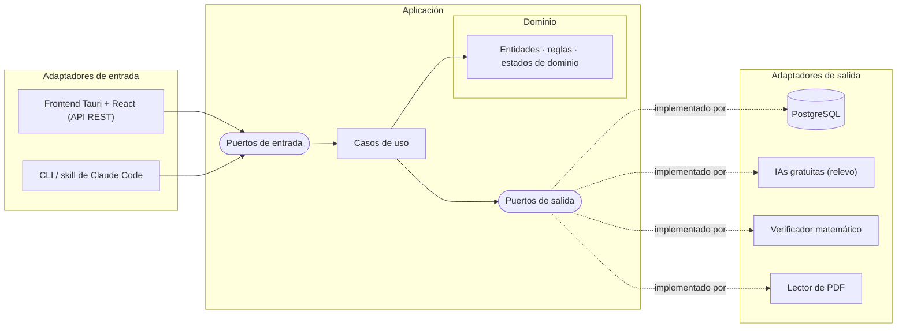

<div align="center">

# 🎓 Lazy Studio

**Un tutor de estudio con IA que no te deja engañarte a ti mismo.**

Aplicación multiplataforma (escritorio primero, después celular y tablet) para preparar exámenes con métodos respaldados por la ciencia del aprendizaje: intentar antes de leer, corregir cada error a tiempo y repasar en el momento justo.


</div>

---

## 📖 Índice
- [Por qué existe](#-por-qué-existe)
- [Visión](#-visión)
- [Cómo enseña](#-cómo-enseña)
- [Tecnologías](#️-tecnologías)
- [Arquitectura](#️-arquitectura)
- [Estructura del proyecto](#-estructura-del-proyecto)
- [Cómo ejecutar](#️-cómo-ejecutar)
- [Estado y hoja de ruta](#️-estado-y-hoja-de-ruta)

---

## 💡 Por qué existe

La mayoría de los estudiantes estudia de la forma que **se siente** productiva: releer apuntes, subrayar, mirar ejercicios resueltos o pedirle un resumen a un chatbot. La investigación sobre el aprendizaje muestra que estas técnicas generan una **ilusión de dominio**: el tema parece claro hasta que hay que resolverlo solo, en el examen.

Lo que de verdad funciona cuesta más: **intentar antes de saber, equivocarse, recibir una corrección precisa y volver a recuperar lo aprendido días después**. Un chatbot genérico hace lo contrario: da la respuesta en cuanto se la pides.

Lazy Studio nació como una *skill* para Claude Code y se probó con un caso real: preparar el 2.º parcial de Cálculo 3 (ecuaciones diferenciales de orden superior). La prueba confirmó que el método funciona, pero también mostró los límites de un prompt. Un modelo de lenguaje **a veces se salta reglas** (deja registros incompletos o adelanta respuestas), una terminal no muestra fórmulas y nada impide que el autocompletado responda por el alumno.

Esta aplicación existe para que **las reglas del método las garantice el código** y la IA se encargue solo de lo que hace bien: explicar, corregir y generar ejercicios.

## 🔭 Visión

> **Que cualquier estudiante llegue a su examen sabiendo resolver solo, y que lo sepa con datos, no por intuición.**

- **Cualquier materia.** Empieza con matemáticas, pero el motor pedagógico no depende del tema.
- **Tu material, no uno genérico.** Los ejercicios salen de tus libros y apuntes, citando libro, página y número.
- **Progreso medible.** Cada concepto tiene un estado de dominio basado en criterios objetivos, no en "creo que ya lo entendí".
- **Un plan que se adapta.** Un calendario hasta la fecha del examen y un repaso espaciado que se reorganiza si te atrasas.
- **Una experiencia de escritorio completa:** fórmulas renderizadas, escritura a mano, panel de progreso, simulacros cronometrados y un visor del libro abierto en la página citada.

## 🧠 Cómo enseña

Cada regla del motor está respaldada por investigación sobre el aprendizaje:

| Principio | En la práctica |
|---|---|
| **Efecto pretest** | Antes de explicar un concepto nuevo, te pide intentarlo. Fallar ahí es lo esperado y prepara la mente para la explicación. |
| **Reversión de la pericia** | Explica directamente al novato, guía con preguntas al intermedio y reta al avanzado. Lo decide por concepto, no en general. |
| **Hipercorrección** | Antes de corregir, pregunta qué tan seguro estás (1–3). Los errores cometidos con seguridad son los que más se aprenden al corregirlos. |
| **Ayuda graduada** | Señala la línea exacta del primer error. Da como máximo dos pistas y después un rescate completo, seguido de un ejercicio nuevo para comprobar. |
| **Recuperación activa** | Nada de resúmenes pasivos: primero reconstruyes tú y luego se completa lo que falta. |
| **Repaso espaciado** | Los fallos vuelven en sesiones futuras, siempre con un ejercicio distinto del original. |
| **Técnica Feynman** | Para cerrar un concepto, lo explicas de memoria y recibes qué omitiste, qué dijiste mal y qué repetiste sin entender. |

Un concepto solo se considera **dominado** 🟢 si lo resuelves a la primera, explicas por qué funciona, resuelves un caso distinto y lo distingues de conceptos parecidos.

## 🛠️ Tecnologías

| Área | Tecnología | Estado |
|---|---|---|
| Lenguaje (backend) | **Java 25 LTS** | ✅ Definido |
| Build | **Maven** (multimódulo, un módulo por capa) | ✅ Definido |
| Framework | **Spring Boot**, solo en adaptadores y arranque; el núcleo es Java puro | ✅ Definido |
| Base de datos | **PostgreSQL** en **Docker** (Docker Compose) | ✅ Definido |
| Migraciones | **Flyway** | ✅ Definido |
| Acceso a datos | **Spring JdbcTemplate**, sin JPA para no contaminar el dominio | ✅ Definido |
| IA | **APIs gratuitas de varios proveedores**, con relevo automático cuando una se queda sin cuota | ✅ Definido |
| Verificación matemática | **SymPy** (servicio Python en Docker) | ✅ Definido |
| Lectura de PDF | **Apache PDFBox** | ✅ Definido |
| Frontend | **Tauri 2 + React + TypeScript** (Windows, Mac, Linux AppImage; después Android e iPhone), KaTeX para fórmulas | ✅ Definido |
| Reglas del frontend | **ESLint** (importaciones en un solo sentido) | ✅ Definido |
| Pruebas | **JUnit 5**, **AssertJ**, **Testcontainers** y **ArchUnit** | ✅ Definido |

## 🏛️ Arquitectura

El proyecto sigue de forma **obligatoria** la **arquitectura hexagonal** (puertos y adaptadores). El núcleo con las reglas pedagógicas no sabe nada de la base de datos, la IA ni la interfaz. Cada tecnología es un adaptador intercambiable.



### Regla de dependencias

Las dependencias apuntan **siempre hacia adentro**. Pruebas con **ArchUnit** la hacen cumplir en cada build.

```
adapters  ──►  application  ──►  domain
bootstrap ──►  todo (solo para conectar las piezas)
```

| Capa | Puede depender de | **Nunca** depende de |
|---|---|---|
| `domain` | Nada (solo la librería estándar de Java) | Frameworks, base de datos, IA, UI |
| `application` | `domain` | Adaptadores, frameworks, infraestructura |
| `adapters` | `application` (sus puertos) y `domain` | Otros adaptadores |
| `bootstrap` | Todo | No contiene lógica de negocio |

### Qué decide el código y qué decide la IA

| 🧮 Código (determinista, en el dominio) | 🤖 IA (detrás del puerto `Tutor`) |
|---|---|
| Estados de dominio y sus transiciones | Explicar un concepto |
| Contador de pistas y paso al rescate | Redactar las pistas |
| Registro de intentos, fallos y sesiones | Ubicar el primer error en un desarrollo |
| Plan de estudio y cola de repasos | Generar ejercicios y variantes |
| Qué concepto y qué ejercicio tocan | Evaluar una explicación Feynman |

## 📁 Estructura del proyecto

Estructura objetivo; se va creando a medida que avanza la construcción.

```
src/                                  # raíz del repositorio
├── docker-compose.yml                # PostgreSQL + backend + verificador
├── backend/                          # Java · hexagonal obligatoria · Maven, un módulo por capa
│   ├── domain/                       # Núcleo: entidades, reglas e invariantes (aprendizaje, planificacion, material)
│   ├── application/
│   │   ├── ports/in/                 # Lo que la app ofrece (CrearLibro, ResponderEjercicio…)
│   │   ├── ports/out/                # Lo que necesita (Tutor, VerificadorMatematico, RepositorioDeLibros…)
│   │   └── usecases/                 # Orquestan, no deciden reglas
│   ├── adapters/
│   │   ├── in/rest/                  # API HTTP que consume el frontend
│   │   └── out/                      # persistencia (PostgreSQL), ia (relevo), verificador, pdf, archivos
│   └── bootstrap/                    # Arranque: conecta puertos y adaptadores; pruebas ArchUnit
├── verificador/                      # Servicio SymPy (Python) en su propio contenedor
└── frontend/                         # Tauri 2 + React + TypeScript · no decide reglas
    ├── src/
    │   ├── app/                      # Arranque y rutas; elige la implementación de platform/
    │   ├── features/<feature>/       # api/ (adaptador) · hooks/ (puerto) · components/ (solo dibujan)
    │   ├── platform/                 # ports.ts + tauri-desktop/ + tauri-mobile/
    │   ├── components/               # Compartidos: Formula, Grafico, VisorPdf, SelectorConfianza
    │   ├── lib/                      # Cliente HTTP base
    │   └── types/                    # Tipos generados desde el backend (OpenAPI)
    └── src-tauri/                    # Empaquetado nativo e instaladores
```

**Convenciones**
1. **Las reglas de negocio viven en `backend/domain`.** Una regla pedagógica en un adaptador, en un caso de uso o en el frontend está en el lugar equivocado. El frontend solo muestra, pide y envía.
2. **Los puertos de salida los define la aplicación**, con nombres del dominio (`Tutor`, no `ClaudeClient`).
3. **El dominio se prueba sin infraestructura.** Los casos de uso usan adaptadores falsos en memoria, y la persistencia se prueba contra un PostgreSQL real con Testcontainers.
4. **Orden de construcción:** dominio → casos de uso → adaptadores.
5. Si una capa crece, se divide por **contexto** (`aprendizaje/`, `planificacion/`, `material/`) sin romper la regla de dependencias.
6. **Frontend:** las importaciones van en un solo sentido (`components, lib, types, platform/ports → features → app`) y una feature no importa de otra. ESLint lo hace cumplir, como ArchUnit en el backend.

## ▶️ Cómo ejecutar

**Requisitos:** Java 25, Node 24, Rust y Docker (con Docker Desktop abierto). En Linux, además, las librerías de Tauri (`webkit2gtk-4.1` y otras; ver la [guía de Tauri](https://tauri.app/start/prerequisites/)).

```bash
cp .env.example .env              # y cambiar POSTGRES_PASSWORD

# Backend (levanta PostgreSQL solo, con docker-compose.yml)
cd backend
./mvnw install -DskipTests        # solo la primera vez o al cambiar un módulo que no sea bootstrap
./mvnw -pl bootstrap spring-boot:run

# Frontend, en otra terminal
cd frontend
npm install
npm run tauri dev
```

La ventana muestra **"Conectado"** cuando el frontend llega al backend y el backend a PostgreSQL. La salud también se puede consultar con `curl localhost:8080/api/salud`.

**Pruebas y reglas de arquitectura**
- Backend: `./mvnw verify` (ArchUnit y pruebas con PostgreSQL real vía Testcontainers).
- Frontend: `npm run lint` (también corre dentro de `npm run build`).
- Verificador SymPy: `docker compose run --rm verificador python -m unittest`.

## 🗺️ Estado y hoja de ruta

> 🚧 **En construcción.** La lógica de negocio está especificada (13/13 partes) y el entorno de desarrollo está listo. Se construye por **porciones verticales**: cada una es una funcionalidad completa, de la base de datos a la pantalla, con su propia migración de Flyway.

- [x] Prototipo como skill de Claude Code (v0.1), probado con Cálculo 3
- [x] Arquitectura y tecnologías definidas
- [x] Especificación de la lógica de negocio: entidades, reglas, estados de dominio y flujos
- [x] **Fase 0 · Cimientos:** PostgreSQL en Docker, backend Maven con ArchUnit, frontend Tauri + React con ESLint y un esqueleto que camina (`/api/salud`)
- [ ] **Fase 1 · Porciones verticales:**
  - [x] Libro y temario
  - [ ] Ejercicio y corrección
    - [x] 2a · ejercicio, intento con confianza, pistas, rescate y semáforo
    - [ ] 2b · verificador matemático (SymPy)
  - [ ] IA con relevo de proveedores gratuitos
  - [ ] Pretest y nivel
  - [ ] Panel de progreso
  - [ ] Repaso espaciado
  - [ ] Material: PDF, banco de ejercicios y visor
  - [ ] Simulacro de examen
  - [ ] Extras: cámara, micrófono, gráficos, Feynman y ajustes
- [ ] **Fase 2 · Primera versión:** instaladores (AppImage, `.exe`, `.dmg`) y prueba real con Cálculo 3
- [ ] **Fase 3 · Después:** servidor central, celular y tablet
